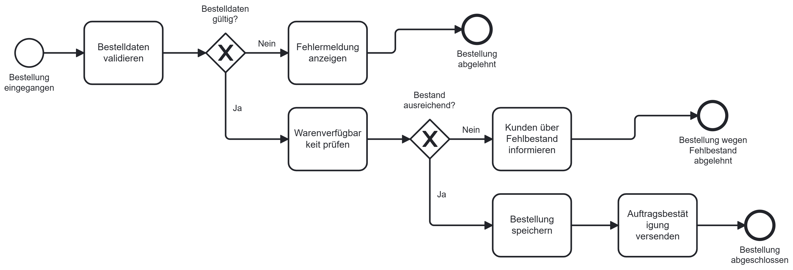

# Digitalisierung eines Bestellprozesses

## 1. Projektübersicht

Dieses Portfolio-Projekt beschreibt die beispielhafte Digitalisierung eines manuellen Bestellprozesses in einem Unternehmen.

Ziel ist es, den bestehenden Bestellprozess zu analysieren, Schwachstellen zu identifizieren und Anforderungen an eine digitale Lösung zu definieren.

Im Mittelpunkt stehen Business Analysis, Requirements Engineering und IT-Projektkoordination.

### Projektziele

- Analyse und Dokumentation des bestehenden Bestellprozesses (Ist-Prozess)
- Identifikation von Schwachstellen und Optimierungspotenzialen
- Entwicklung eines optimierten digitalen Zielprozesses (Soll-Prozess)
- Definition und Priorisierung fachlicher Anforderungen
- Erstellung von User Stories und Akzeptanzkriterien
- Vorbereitung und Dokumentation von Testfällen

**Projekttyp:** Fiktives Praxisprojekt für ein professionelles IT-Portfolio.

## BPMN-Prozessmodell

Das BPMN-Modell visualisiert den digitalen Soll-Bestellprozess einschließlich Bestellvalidierung, Bestandsprüfung und alternativer Prozessabläufe.

[BPMN-Modell herunterladen](Bestellprozess-Soll-BPMN.bpmn)

### BPMN-Prozessdiagramm

Die folgende Abbildung zeigt den digitalen Soll-Bestellprozess mit den wichtigsten Entscheidungspunkten und Prozessabläufen.

